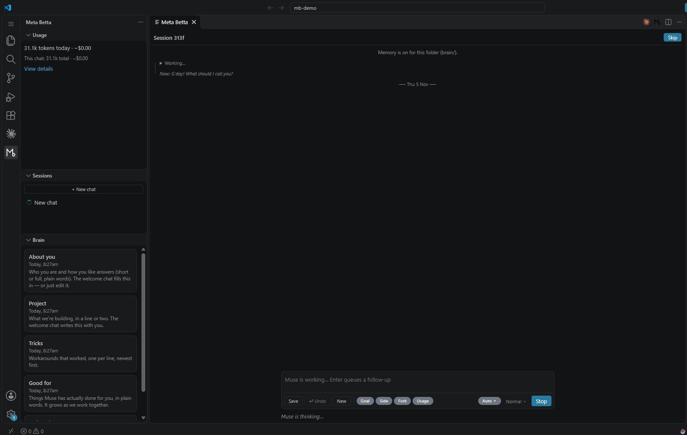
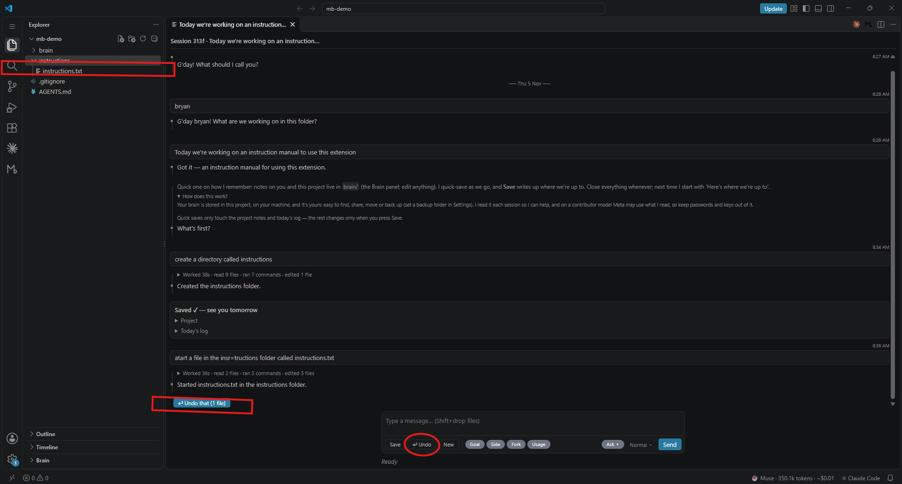
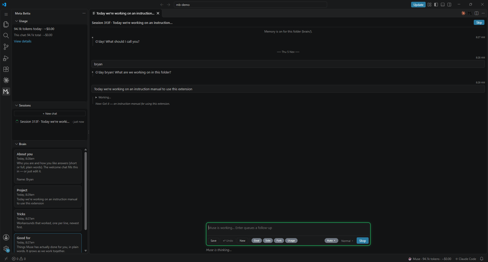
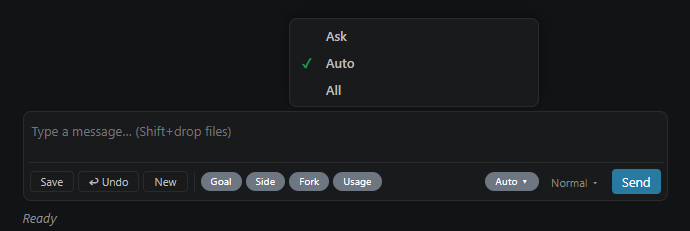
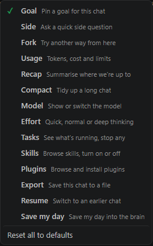
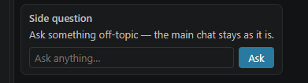

# Meta Betta — we just made it play nice

**Coffee and Muse. New mornings without the restarts.** Start the day with a colleague, not a tool.

A friendly workmate for Meta's Muse Code: a chat panel in VS Code, with a brain folder that remembers you and your project, so every session starts where you left off.

## Install

1. Download `meta-betta-0.1.0.vsix` from the latest [Release](https://github.com/madazz01/meta-betta/releases).
2. In VS Code: Extensions view (Ctrl+Shift+X) → `…` → **Install from VSIX…** → pick the file.
3. Open a project folder, click the **M** icon on the left, then **New chat**. The first run sets up Muse and your Meta API key right there in the panel.

## Your first day

**What it is:** a chat with Muse that remembers you. You talk, Muse does the work in your folder, and tomorrow it picks up where you left off.



1. **Just talk to it.** Type what you want in plain words and hit **Send**. "Make me a simple web page for my shop" is fine. Under each reply there's a one-line summary of what it did. Click it to see every step. Didn't like a change? Hit **↩ Undo that** under the reply.

   
2. **It gets to know you.** On day one it asks a few easy questions about you and what you're building. That goes in a `brain/` folder in your project, in plain text files you can open and read.

   
3. **Hit Save before you finish.** It writes up what you did, what's left and anything that worked, into the brain. It also saves on its own every so often, so you won't lose much if you forget.
4. **Come back tomorrow.** Open the folder, click **M**, and it starts with "here's where we're up to". No explaining it all again.

<!-- screenshot: docs/images/morning.png (the morning pick-up) -->

**The buttons**

| Button | What it does |
|---|---|
| **Save** | Saves your day into the brain ("Saved ✓ see you tomorrow") |
| **↩ Undo** | Puts back whatever the last reply changed. Each reply also has its own **Undo that** |
| **New** | A new chat in a new tab |
| **Auto ▾** | How much it asks first. **Ask**: you OK every step. **Auto**: safe stuff in your folder just goes, anything else asks. **All**: no asking (careful) |
| **Normal ▾** | How hard Muse thinks. Deep is slower and uses more credits |
| **Goal · Side · Fork · Usage** | Shortcuts. Goal: pin the job for this chat. Side: a quick question that doesn't derail the main chat. Fork: try another way in a new tab. Usage: your credits |



**Make the shortcuts yours.** Right-click any shortcut to swap it for another: recap, tidy up a long chat, switch model, see running tasks, skills, plugins, export the chat, go back to an earlier chat, or save my day. Type **/** to use any of them without a button.



**Side** opens a little box for an off-topic question. The answer comes back without messing up the main chat.



**Handy to know**

- Paste a screenshot straight into the box (Win+Shift+S, then Ctrl+V). Hold **Shift** while you drop a file in.
- Keep typing while it works. Your message waits in a queue, or you can send it straight into the running job.
- **Stop it** really stops it.
- The sidebar shows your brain, past chats and how many credits you've used.

**Honest notes**

- Tested on Windows 11. Mac and Linux should work, but we haven't checked them.
- It uses your own Muse credits.
- On Windows, Muse's sandbox doesn't work in serve mode yet, so Meta Betta runs with a safe workaround: Muse asks before running commands. **Approvals: Auto** skips the safe ones inside your folder. See [WHAT-WE-FOUND.md](WHAT-WE-FOUND.md).
- Every reply's changes can be undone (↩ Undo), and files are backed up to `.backups/` before they're changed.
- Your API key lives in VS Code's secret store, never in a file.
- On Muse's contributor model, keep secrets out of the folder you open.
- Found a problem? [Open an issue](https://github.com/madazz01/meta-betta/issues).

**Built something with it?** Paste this into your README:

```
[](https://github.com/madazz01/meta-betta)
```

[](https://github.com/madazz01/meta-betta)

Built for the Meta Global AI Developer Hackathon (27 Oct – 4 Nov 2026). Everything in this repo was written during the hackathon.

## Why I entered

The prize money would be lovely, not gonna lie. But that's not really why I do hackathons. I like pushing myself to hit a goal with a hard deadline, and seeing what I can actually create in that time. A focused time limit is the best way I know to test myself.

9 months in since the first time I ever used AI and counting.

## Who built what

Meta Betta is built the way it asks you to work: one human steering, AIs doing the grunt work, nothing forgotten between sessions.

- **Bryan (madazz01)** — the idea, the decisions, and every "that's not right" check.
- **Muse Code** (Meta's coding agent, `muse-spark-1.3`) — wrote the extension code, one brief at a time. Its commits end with `Built-by: Muse Code (…)`, and its own session logs for each brief are exported to [`docs/build-log/`](docs/build-log/).
- **Claude Code** (Anthropic) — wrote the build briefs ([`AGENTS.md`](AGENTS.md), [`docs/briefs/`](docs/briefs/)), the early SDK spike ([`spike/`](spike/)), and reviewed each brief's work. Its commits end with `Co-Authored-By: Claude …`.

`git log` shows who did each step.

## What we found while building

Driving Muse through its SDK every day threw up a few hurdles: a Windows sandbox bug in serve mode (and a safe workaround), how to build a real Stop button, and a notification gotcha. All written up with repro scripts in [`WHAT-WE-FOUND.md`](WHAT-WE-FOUND.md).

## Free for everyone

Meta Betta is free and open source under the [MIT licence](LICENSE): use it, change it, share it. You still need Muse Code itself, and Muse usage is billed by Meta as usual (free credits, plan or pay as you go).

Work in progress.
